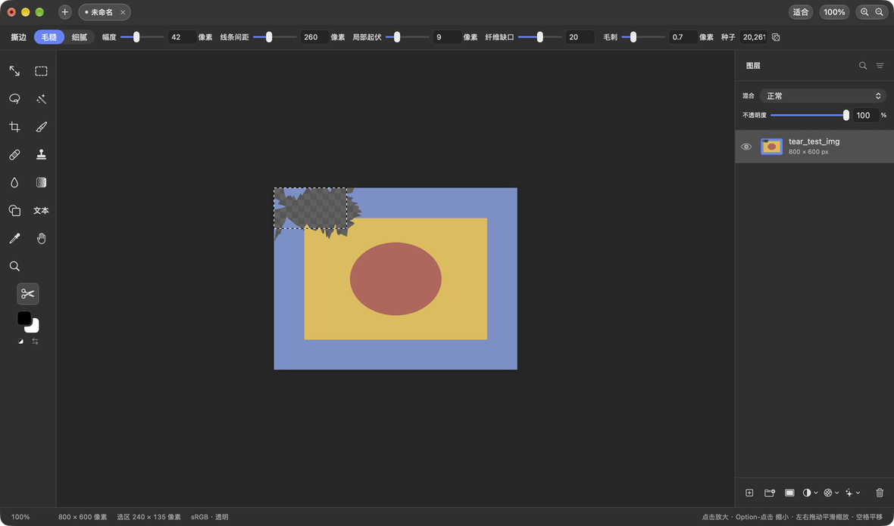
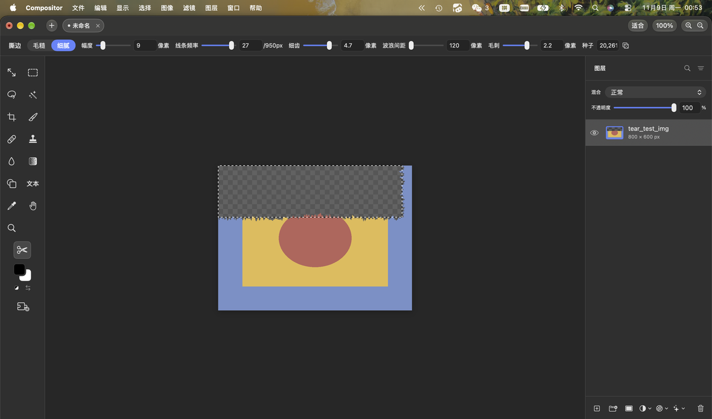
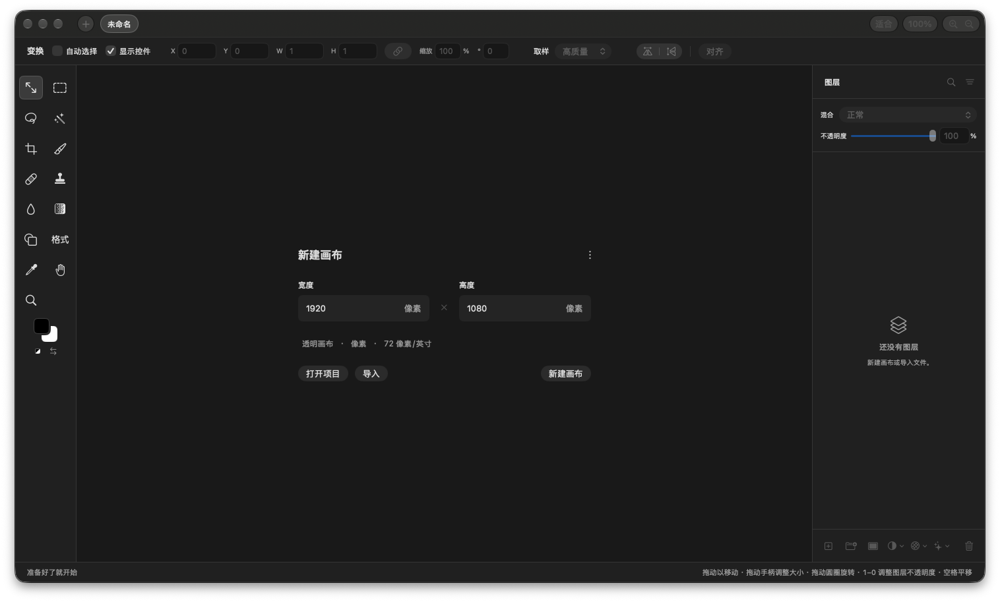
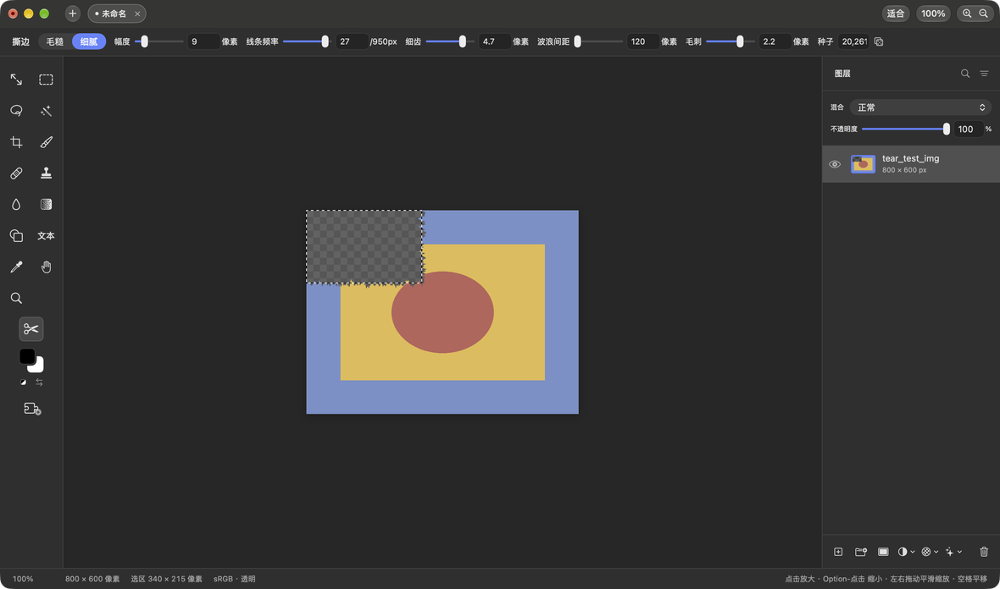

# Compositor-CN

**Compositor 的非官方简体中文完整汉化 + 插件生态增强版。**

> Compositor 是 Mac 上一款广受好评的图像编辑器（"The Photoshop alternative for Mac"，
> 18k+ stars）：[robbietilton/Compositor](https://github.com/robbietilton/Compositor)。
> 上游明确表示暂不接受翻译 PR，本项目作为独立维护的下游版本，为其提供完整简体中文支持，
> 并在源码层面新增了一套插件系统。

**⚠️ 非官方声明**：本项目与上游 Compositor 及 Wonder Assembly LLC 无任何隶属关系。
Compositor 主程序源码基于上游 MIT 许可修改再分发（上游版权声明见
[源码/LICENSE-上游-MIT.txt](源码/LICENSE-上游-MIT.txt)）；建议从官方渠道获取原版 App。

---

## ✨ 项目特点

| 特性 | 说明 |
|---|---|
| 🇨🇳 **完整简体中文汉化** | **1680 条**词条全量覆盖，术语对齐 Adobe Photoshop 中文版惯例（正片叠底、色彩范围、内容识别填充……），完整对照见 [术语表.md](术语表.md) |
| 📦 **语言包驱动架构** | 界面文案 **100%** 由 `Localizable.strings` 决定——改文案、换语言，**替换语言包即可，无需改源码重新编译**（AppKit 菜单、动态拼接串等 SwiftUI 查表覆盖不到的路径已在源码层全部接入查表入口） |
| 🧩 **插件系统** | 纯 **C ABI v2** 的 `.compositorplugin` 体系：`dlopen` + 手动偏移 entry 结构，宿主与插件之间零 Swift 类型，跨 Swift 版本稳定。**新增插件不需要重编译主程序** |
| 🛠 **两个开箱即用的插件** | [撕边插件](#-插件一撕边-torn-edge)（画布效果类）与 [Web 导出插件](#-插件二web-导出-web-export)（压缩导出类），同时是插件开发的两个完整参考实现 |
| 🔁 **可复现构建** | 自包含源码基线 + 一键编译脚本 + 词表校验门禁，clone 下来即可复现全部产物 |

## 效果预览

| 撕边插件（毛糙档） | 撕边插件（单边齐平裁切） | 汉化后主界面 |
|---|---|---|
|  |  |  |

## 环境要求

- **Apple Silicon Mac**（arm64），macOS 26+ 实测
- **Compositor 1.6.4 (build 63)** ——安装脚本带版本守卫，其他版本只注入语言包、不替换二进制
- 编译需要 **Xcode Command Line Tools**（编译脚本按 `MacOSX26.5.sdk` 固化，
  本机 SDK 版本不同时改脚本顶部 `SDK` / `TARGET` 两个变量即可）

## 🚀 快速开始

```bash
git clone https://github.com/zhuiszhu1/Compositor-CN.git
cd Compositor-CN

# ① 编译汉化版宿主（产物自动落到 重编译二进制/）
./源码/重新编译.command

# ② 安装汉化（自动备份原版 → 注入语言包 → 换二进制 → 重签名 → 验签）
./安装汉化.command

# ③（可选）编译安装两个插件
./撕边插件/编译撕边插件.command
./导出插件/编译导出插件.command
```

然后 **⌘Q 完全退出 Compositor 再重新打开**。

- 安装脚本**幂等**，可重复运行；默认目标是 `/Applications/Compositor.app`，
  可用 `COMPOSITOR_APP=/path/to/副本.app ./安装汉化.command` 在副本上预演
- 改动仅限 App 包内资源 / Info.plist / 主二进制，不碰项目文件、偏好设置与沙盒容器
- **还原官方原版**：`./卸载还原.command`（从备份恢复，不删除任何东西）
- ⚠️ 改包后主程序为 ad-hoc 本地签名，首次打开会提示「来自身份不明的开发者」→
  右键 → 打开（或系统设置里放行）即可；Sparkle 自动检查更新已关闭，避免官方更新覆盖汉化

## 🧩 插件一：撕边（Torn Edge）

把「撕纸毛边」效果做成画布工具：沿选框边缘撕出自然的裁纸毛边，框内内容删除，
⌘Z 可撤销（与画笔同一撤销通道）。

**用法**：

1. 左侧工具栏选择 **剪刀** 按钮
2. 顶部参数区调整风格与参数（见下表）
3. 画布上拖出选框
4. 按 **Delete（退格）** → 沿选框边缘呈现撕纸效果

**参数**（同参数同种子逐点可复现，骰子按钮换随机种子）：

| 组 | 参数 | 说明 |
|---|---|---|
| 风格 | 毛糙 / 细腻 | 切换下方对应参数组 |
| 毛糙 | 幅度 / 线条间距 / 局部起伏 / 纤维缺口 | 大尺度控制点 + 中频起伏 + 逐列毛刺 + 钟形纤维缺口 |
| 细腻 | 幅度 / 线条频率 / 细齿 / 波浪间距 | 慢漂移 + 高斯圆钝小齿 + 准周期中频波 |
| 共用 | 毛刺 / 种子 | 逐列微毛刺 + 随机种子 |

**单边齐平裁切**：选区的某条边与图层可见边缘齐平（容差 2 文档像素）时，该边不撕、
沿选框边直线全像素裁切——比如选框贴图层顶部全宽，就只撕下边。例：

| 双边撕边 | 单边撕边 |
|---|---|
|  |  |

## 🧩 插件二：Web 导出（Web Export）

以**压缩文件尺寸**为核心的导出插件（ABI v2 · export 类），位于 **文件菜单 → Web 导出…**。
面板提供实时预览、真实大小显示与 PNG 参照对比（「省 X%」）。

| 档位 | 质量 | PNG 模式 |
|---|---|---|
| 高质量 | q92 | 全彩 |
| 标准（默认） | q82 | 全彩 |
| 极限 | q62 | PNG8 64 色 |
| 自定 | 手动调参 | 手动调参 |

**格式支持**：

| 格式 | 编码管线 | 透明处理 |
|---|---|---|
| WebP 有损/无损 | 内置 libwebp 1.6.0（macOS ImageIO 不支持 WebP 编码，故自带） | alpha 保留 |
| JPEG | ImageIO | 白底填充 |
| PNG 全彩 | ImageIO 无损 | alpha 保留 |
| PNG8 调色板 | 中位切分量化 + 手写 PNG chunk（PLTE/tRNS/deflate-9） | 二值透明 |
| GIF | 同量化管线 + 手写 GIF89a（LZW） | 透明 index |

**压缩率实测**（1200×800，PNG 全彩为基准）：照片渐变图 PNG 40KB → WebP q82 **8KB（省 80%）**；
插画图 PNG 19KB → PNG8 64 色 **3KB（省 84%）**。**缩放（5–100%）是体积压缩的第一杠杆**。

## 插件的安装方式（通用）

- **编译安装**：跑插件目录里的 `编译*.command`（产物装入 App 包 `Contents/Plugins/`）
- **运行时导入**：Compositor 左侧工具栏底部 **「导入插件」按钮**（拼图+加号图标），
  选择任意 `.compositorplugin` 即刻加载，无需重启、无需重编宿主
- 宿主按序扫描两个目录，**用户目录优先**：
  1. `~/Library/Application Support/Compositor/Plugins/`（导入按钮装入这里）
  2. App 包内 `Contents/Plugins/`（编译脚本装入这里）
- 同 identifier 先到先得；导入失败自动回滚（坏插件不留容器）

## 🔨 从源码构建

| 路径 | 说明 |
|---|---|
| `源码/Compositor/` | 自包含改造源码基线（188 Swift + 10 C，语言包驱动全量改造） |
| `源码/重新编译.command` | 一键可复现构建（产物 → `重编译二进制/Compositor-zh-v7`） |
| `源码/词表校验.py` | 词表维护门禁：提取源码全部 `L("…")` 显式 key 与词表比对，缺失即报错 |
| `重编译源码补丁.patch` | 相对上游源码的全量改动（3932 行 / 60 文件段，`patch -p1` 可复现） |

改动上游时的工作流：改源码 → `python3 源码/词表校验.py`（0 缺失）→ 重新编译 → 安装脚本落地。

## 🧑‍💻 开发你自己的插件

宿主内置插件系统：**画布工具类**（复用选框交互 + Delete 触发撕除，参数面板按 schema 自动渲染）
与 **导出类**（进文件菜单，带实时预览与档位预设）两种形态，加插件不重编主程序。

完整开发指南（ABI 契约、参数 schema 字段参考、可照抄的最小骨架、打包签名、实战踩坑清单）
见 **[docs/插件开发规范.md](docs/插件开发规范.md)**；
`撕边插件/` 与 `导出插件/` 两个目录就是完整的参考实现。

## 📁 目录结构

```
Compositor-CN/
├── README.md                  ← 本文件
├── LICENSE                    ← 本项目许可（MIT）
├── 术语表.md                  ← 中英术语对照（对齐 Photoshop 中文版）
├── zh-Hans.lproj/
│   └── Localizable.strings    ← 中文字符串表（1680 条，核心交付）
├── 安装汉化.command           ← 备份 → 注入 → 换二进制 → 重签名 → 验签
├── 卸载还原.command           ← 从备份恢复官方原版
├── 重编译源码补丁.patch       ← 相对上游源码的全量改动
├── 源码/
│   ├── Compositor/            ← 改造后的完整源码基线（188 Swift + 10 C）
│   ├── Sparkle.framework/     ← 编译用框架（提取自官方 App，见 Sparkle-LICENSE.txt）
│   ├── LICENSE-上游-MIT.txt   ← 上游 MIT 许可全文（保留义务）
│   ├── 重新编译.command       ← 一键编译宿主
│   └── 词表校验.py            ← 词表完整性门禁
├── 撕边插件/                  ← TornEdge 插件（ABI v1 · 画布类）+ 编译脚本
├── 导出插件/                  ← WebExport 插件（ABI v2 · 导出类）+ vendored libwebp + 编译脚本
├── docs/
│   ├── 插件开发规范.md        ← 插件开发完整指南
│   └── 开发日志.md            ← 完整开发过程记录（事故复盘、验证方法、架构决策）
└── 验收截图/                  ← 效果截图
```

## 📄 许可与致谢

- 本项目以 **[MIT](LICENSE)** 许可开源
- 上游 Compositor：MIT（Copyright © 2026 Wonder Assembly LLC）——
  全文保留于 [源码/LICENSE-上游-MIT.txt](源码/LICENSE-上游-MIT.txt)
- [Sparkle](https://github.com/sparkle-project/Sparkle)：MIT（[源码/Sparkle-LICENSE.txt](源码/Sparkle-LICENSE.txt)）
- [libwebp](https://github.com/webm-project/libwebp)：BSD 三条款（[导出插件/libwebp-src/COPYING](导出插件/libwebp-src/COPYING)）
- 汉化术语参考 Adobe Photoshop 简体中文版惯用译名

---

适用于 Compositor 1.6.4 (build 63) / Apple Silicon。上游若新增文案，未收录的条目保持英文，不会报错。
